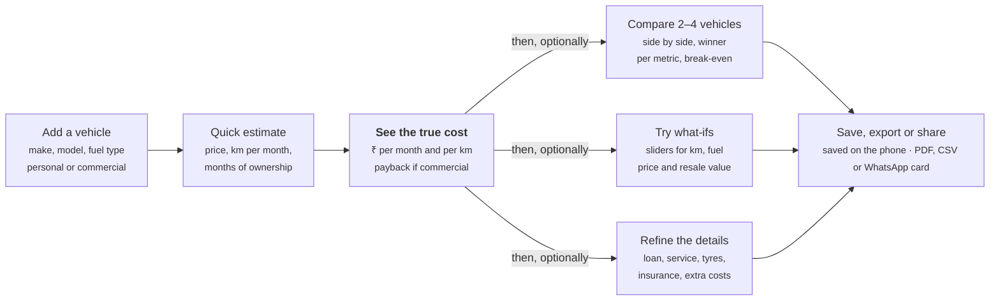

# GaadiGanit — Vehicle Cost & ROI Calculator for India

> **Source:** [Claude Doc: GaadiGanit Product Spec](https://claude.ai/artifact/JGfPjSQnzvHX1tpN9wSQja), as of 2026-11-23.
> This file is a copy of that doc. Treat it as the product intent; the detailed requirements live in [SPEC.md](SPEC.md).

## Name

Recommended name: **GaadiGanit** ("vehicle maths"). It is short, Hindi-English like most Indian consumer apps, and says what the app does.

| Name | Meaning | Why it could work |
| --- | --- | --- |
| **GaadiGanit** (recommended) | Gaadi = vehicle, Ganit = maths | Clear, memorable, works for cars, SUVs and commercial vehicles |
| Gaadi Hisaab | Vehicle accounts | Feels like a family ledger; friendly for non-technical buyers |
| KharchaMeter | Expense meter | Works if the app later tracks real running costs after purchase |
| AsliKeemat | The real price | Leans into the core insight: on-road price is not the true cost |
| DriveWorth | Is the drive worth it | English-only option if you target a pan-India or NRI audience |

Open check: search the Play Store, App Store, domain registrars and the Indian trademark registry (IP India) before committing.

## Product intent

GaadiGanit tells an Indian buyer what a vehicle will really cost over the period they plan to own it, and how that compares with other vehicles or with not buying at all. It turns a vague "is this car worth it?" into one number per month and per km.

**Problem.** Buyers compare on-road price and claimed mileage, then get surprised by fuel, insurance renewals, servicing, tyres, EMI interest and resale loss. Doing this properly today means a messy spreadsheet.

**Primary users**

- First-time and upgrading car buyers comparing 2–4 shortlisted models
- Buyers choosing between fuel types: petrol vs diesel vs CNG vs hybrid vs EV
- Small business owners and fleet or cab operators evaluating commercial four-wheelers and larger vehicles (vans, pickups, mini-trucks), where earnings matter as much as cost

**Goals**

1. Show total cost of ownership (TCO) for a chosen ownership period, in months.
2. Show cost per month and cost per km, so different vehicles compare fairly.
3. Show ROI or payback for commercial use: monthly earnings minus costs, and months to recover the investment.
4. Compare up to 4 vehicles side by side, including a break-even point (for example, the km per month at which an EV beats petrol).
5. Work with sensible Indian defaults so a user gets an answer in under 2 minutes, then refine.

**Non-goals for v1**

- No live dealer pricing, bookings or loan applications
- No used-car valuation engine; resale is a user-entered or default percentage
- No post-purchase expense tracking (a possible v2, see roadmap)
- Two-wheelers are out of scope at launch but the model should not block adding them

## Core user flow

A user gets a first answer from 5 fields, then chooses whether to compare, test scenarios or refine.



Every calculation recalculates instantly as inputs change, and every path ends in a saved or shared result.

## Inputs and data model

Every input below has an editable default, so only vehicle, price and usage are required to get a first result. All money is in INR (₹) with Indian digit grouping (₹12,34,567).

**Vehicle profile**

| Field | Type | Required | Default or note |
| --- | --- | --- | --- |
| Nickname | text | no | e.g. "Dad's new SUV" |
| Make | text / picker | yes | Maruti Suzuki, Tata, Mahindra, Hyundai, Toyota, Kia… |
| Model | text / picker | yes | Free text allowed |
| Variant | text | no | e.g. ZXi+, AMT |
| Category | enum | yes | Hatchback, sedan, compact SUV, SUV, MPV, pickup, van, mini-truck, bus |
| Fuel type | enum | yes | Petrol, diesel, CNG, strong hybrid, EV, dual (petrol + CNG) |
| Use type | enum | yes | Personal or commercial |
| City / state | picker | no | Drives road-tax and fuel-price defaults |

**Purchase cost**

| Field | Type | Default or note |
| --- | --- | --- |
| Ex-showroom price | ₹ | Required |
| Road tax / registration | ₹ or % | State-based default %; user can override |
| Insurance, year 1 | ₹ | Default % of ex-showroom by category |
| Accessories, extended warranty, FASTag, handling | ₹ | 0 |
| Discounts / exchange bonus | ₹ | 0, subtracted |
| GST slab (info only) | enum | 5% EV, 18% small car, 40% larger cars, shown for transparency since it is already inside ex-showroom |

**Financing (optional)**

| Field | Type | Default or note |
| --- | --- | --- |
| Down payment | ₹ or % | 20% |
| Loan interest rate | % p.a. | Editable default |
| Loan tenure | months | 60 |
| Processing fee | ₹ | 0 |

**Usage and energy**

| Field | Type | Default or note |
| --- | --- | --- |
| Ownership period | months | 60 |
| Distance driven | km per month (or per day × days) | 1,000 |
| Fuel price | ₹ per litre / kg / kWh | City default, editable |
| Mileage | km per litre / km per kg / km per kWh | Prefill ARAI claim, but default to a real-world factor (about 75% of claimed) |
| Fuel price inflation | % per year | Editable default |
| Dual-fuel split | % of km on CNG | Only for dual fuel |
| EV home vs public charging split | % | Only for EV |

**Running and maintenance**

| Field | Type | Default or note |
| --- | --- | --- |
| Scheduled service cost | ₹ per service + interval in km or months | By category and fuel type |
| Tyres | ₹ per set + life in km | By category |
| Battery (12V) and EV battery reserve | ₹ + interval | Optional |
| Insurance renewal | ₹ per year or % decline per year | Auto-declines with IDV |
| Parking, tolls, cleaning | ₹ per month | 0 |
| Unplanned repairs buffer | ₹ per year | Small default |
| Custom line items | name + ₹ + frequency | For anything else |

**Exit value**

| Field | Type | Default or note |
| --- | --- | --- |
| Expected resale value | ₹ or % of ex-showroom | Depreciation curve by age and fuel type |

**Commercial only (ROI mode)**

| Field | Type | Default or note |
| --- | --- | --- |
| Earnings | ₹ per km, per trip or per month | Required in commercial mode |
| Driver salary | ₹ per month | 0 if owner-driven |
| Permits, fitness certificate, commercial insurance | ₹ per year | Category default |
| Platform commission | % of earnings | For aggregator cabs |
| Idle days | days per month | 4 |

**Stored entities**: `Vehicle`, `Scenario` (a vehicle plus usage, finance and cost settings), `Comparison` (2–4 scenarios), `DefaultsPack` (versioned defaults by state and category).

## Calculation engine

The engine is a pure, unit-tested function: `calculate(scenario, defaults) → result`, computed month by month over the ownership period N so inflation, insurance decline and service intervals land in the right month.

**Upfront cost**

```latex
\text{OnRoad} = \text{ExShowroom} + \text{RoadTax} + \text{Insurance}_1 + \text{Accessories} - \text{Discounts}
```

**Monthly energy cost** (price inflates yearly by rate i; mileage uses the real-world factor)

```latex
\text{Energy}_m = \frac{\text{km}_m}{\text{Mileage} \times \text{RealWorldFactor}} \times \text{FuelPrice} \times (1 + i)^{\lfloor m/12 \rfloor}
```

Dual-fuel and EV charging split the km by the user's percentage and sum each part.

**EMI** (P = loan amount, r = monthly rate, n = tenure in months)

```latex
\text{EMI} = P \cdot \frac{r(1+r)^n}{(1+r)^n - 1}
```

**Total cost of ownership over N months**

```latex
\text{TCO} = \text{DownPayment} + \text{UpfrontOther} + \sum_{m=1}^{N}\left(\text{EMI}_m + \text{Energy}_m + \text{Service}_m + \text{Tyres}_m + \text{Insurance}_m + \text{Other}_m\right) + \text{LoanOutstanding}_N - \text{Resale}_N
```

If paid in cash, EMI is zero and the full on-road price is upfront. Add an optional opportunity cost: interest the cash would have earned at a user-set FD rate.

**Derived metrics**

- Cost per month = TCO ÷ N
- Cost per km = TCO ÷ total km
- Depreciation = on-road price − resale value
- Interest paid = total EMIs − principal

**Commercial ROI mode**

```latex
\text{NetProfit}_m = \text{Earnings}_m - \text{Commission}_m - \text{Driver}_m - \text{RunningCost}_m - \text{EMI}_m
```

- ROI % = (sum of net profit + resale − upfront investment) ÷ upfront investment × 100
- Payback month = first month where cumulative net profit covers the upfront investment

**Comparison and break-even**

- Break-even km per month between two vehicles: the km/month at which their TCOs are equal (solve numerically)
- Break-even month: the month where cumulative costs cross, for example a pricier EV overtaking a cheaper petrol car
- Sensitivity: show how TCO moves when fuel price, km/month or resale change by ±20%

**Rules for the engine**

- All money in paise as integers internally to avoid floating-point drift; format only at display
- Every default carries a source and an as-of date so the UI can show "based on" notes
- Inputs validated with a schema (e.g. Zod); impossible values rejected with a clear message

## Outputs and screens

The result screen leads with one headline: "This car costs you ₹18,400 a month, or ₹18.4 per km, over 5 years."

**Screens**

| Screen | What it does |
| --- | --- |
| Home | Saved scenarios and comparisons; "New calculation" button |
| Quick estimate | 5 fields only: model, fuel type, price, km/month, months. Answer on the same screen |
| Detailed editor | Tabbed sections: Vehicle, Purchase, Finance, Usage, Maintenance, Resale, Commercial. Each section collapses with its subtotal shown |
| Result | Headline cost, cost breakdown, cumulative cost chart, key assumptions list |
| Compare | 2–4 scenarios side by side, winner per metric, break-even chart |
| What-if | Sliders for km/month, fuel price, ownership months, resale %; result updates live |
| Settings | Language (English, Hindi first), currency format, default city, defaults pack version |

**Charts on the result and compare screens**

- Cost breakdown: where the money goes (EMI or price, fuel, service, insurance, tyres, other, minus resale)
- Cumulative cost over months, one line per vehicle, with crossover points marked
- For commercial mode: cumulative profit line with the payback month marked

**Sharing**

- Export a one-page PDF summary for family discussion
- Share link or WhatsApp card image with the headline numbers
- Export inputs and results as CSV

## Tech approach and roadmap

Build v1 as an offline-first web app (PWA) so it works on any phone without an install, then wrap it as Android first, since most Indian buyers are on Android.

**Suggested stack** (Claude Code may propose alternatives with reasons)

- Frontend: React + TypeScript, Vite, Tailwind; Recharts for charts; React Hook Form + Zod for inputs
- Calculation engine: a standalone TypeScript package with no UI dependencies, 100% unit-tested (Vitest)
- Storage: local first (IndexedDB) so no login is needed in v1; optional cloud sync later
- Defaults: a versioned JSON file of state road-tax rates, fuel prices, insurance %, service costs and depreciation curves
- i18n: English and Hindi from day one; structure ready for Tamil, Telugu, Marathi, Bengali
- Mobile: Capacitor or React Native wrapper in phase 2

**Phases**

1. **v1 MVP**: single-vehicle calculator (personal use), quick estimate + detailed editor, result screen with breakdown and cumulative chart, local save, Indian number formatting
2. **v1.1**: compare up to 4 vehicles, break-even and what-if sliders, PDF and WhatsApp share
3. **v1.2**: commercial ROI mode (earnings, driver, permits, payback), fleet of N identical vehicles
4. **v2**: model catalogue with prefilled prices and mileage, live fuel prices by city, Android app, optional login and sync
5. **v3**: post-purchase tracker (log real fuel fills and service bills to compare actual vs predicted), two-wheelers, used-car mode, loan partner integrations

**Open questions**

- Free, freemium or ad-supported? Affects whether login is needed early.
- Where do model prices and mileage come from in v2: manual curation, a licensed data feed, or user contributions?
- Should EV battery degradation and replacement be modelled in v1 or later?

## Hand-off to Claude Code

Paste this whole doc into Claude Code (export it as Markdown), followed by the prompt below. It asks Claude Code to turn this intent into a detailed spec and then fan the work out in parallel.

```markdown
You are building GaadiGanit, a vehicle cost-of-ownership and ROI calculator for Indian buyers. The product intent is above.

Step 1: Write SPEC.md
- Expand each section into detailed requirements with acceptance criteria
- Define TypeScript types for Vehicle, Scenario, Comparison, DefaultsPack and CalculationResult
- List every default value with a placeholder source and as-of date in defaults/india.json
- Ask me up to 5 questions where the intent is ambiguous, then stop and wait

Step 2: Plan the build
- Split the work into independent workstreams with clear interfaces:
  1. Calculation engine package (pure TS, full unit tests, money in paise)
  2. Defaults pack (state road tax, fuel prices, insurance, service, depreciation)
  3. UI shell, routing, i18n (English + Hindi), Indian number formatting
  4. Input forms (quick estimate + detailed editor) with Zod validation
  5. Results, compare and what-if screens with charts
  6. Persistence (IndexedDB) and export (PDF, CSV, share image)
- Write PLAN.md with the workstreams, their dependencies and the order to merge

Step 3: Fan out
- Build the engine and its types first, since every UI stream depends on them
- Then run the remaining workstreams in parallel with sub-agents, each in its own branch or worktree, each with its own tests
- Integrate, run the full test suite, and fix failures

Step 4: Verify
- Hand-check 3 worked examples against a spreadsheet: a petrol hatchback, a diesel SUV on loan, and a commercial CNG cab
- Confirm break-even between a petrol car and an EV is computed correctly
- Report what was built, what was skipped and the open questions

Scope for this run: phase v1 MVP only, unless I say otherwise.
```

**Tips for the hand-off**

- Keep the engine separate from the UI; it is the part that must be right, and it can later power a WhatsApp bot or API.
- Ask for the 3 worked examples early; they catch formula mistakes faster than UI review.
- Defaults like fuel prices, road tax and GST change often, so treat them as data, never hard-coded constants.

## Sources

- GST slabs on cars since 22 Sept 2025 (5% EV, 18% small cars, 40% others): [Razorpay](https://razorpay.com/learn/gst-on-cars/), [Business Standard](https://www.business-standard.com/economy/news/gst-rationalisation-to-boost-auto-demand-small-cars-suvs-tyres-125090400227_1.html)
- Other defaults in this spec (real-world mileage factor, down payment, tenure) are placeholders to be verified while writing SPEC.md.
